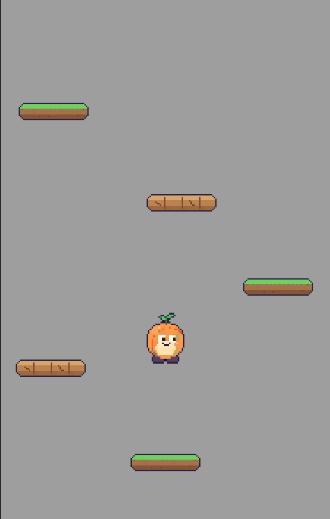

# Seed Jump

An endless vertical platformer made with Unity 6. Help a little seed climb as high as it can by bouncing from platform to platform.

**▶ Play in your browser:** [enskrkmz.itch.io/seed-jump](https://enskrkmz.itch.io/seed-jump)

## How to Play

| Action | Control |
|---|---|
| Move left | A / ← or hold the left half of the screen |
| Move right | D / → or hold the right half of the screen |

- The seed bounces automatically when it lands on a platform.
- Leave the screen on one side to come back on the other.
- Wooden platforms break after you use them.
- Fall below the screen and the game is over. Your score is how high you climbed.

## Features

- Endless, randomly placed platforms
- One-way platforms you can jump through from below
- Breakable wooden platforms
- Screen wrap on both sides
- Height-based score
- Works with keyboard, mouse and touch (new Input System)

## Built With

- Unity 6 (6000.3 LTS)
- C#
- Unity Input System

## What I Learned

- **Object pooling**: instead of creating and destroying platforms, the ones that fall below the camera are moved back to the top
- One-way platforms with **Platform Effector 2D**
- Bouncing only when falling, using the collision's `relativeVelocity`
- Moving a physics object through **velocity** instead of `Transform.Translate`, and why mixing the two causes jitter
- Disabling a renderer and collider instead of the whole GameObject, so its scripts keep running
- A camera that follows the player upward only
- Combining keyboard and touch input into a single direction value with the **new Input System**

## Credits

- Inspired by *Doodle Jump*. This is a learning project and is not affiliated with the original game.
- All code made by me.
- Character and platform sprites created with AI assistance.
